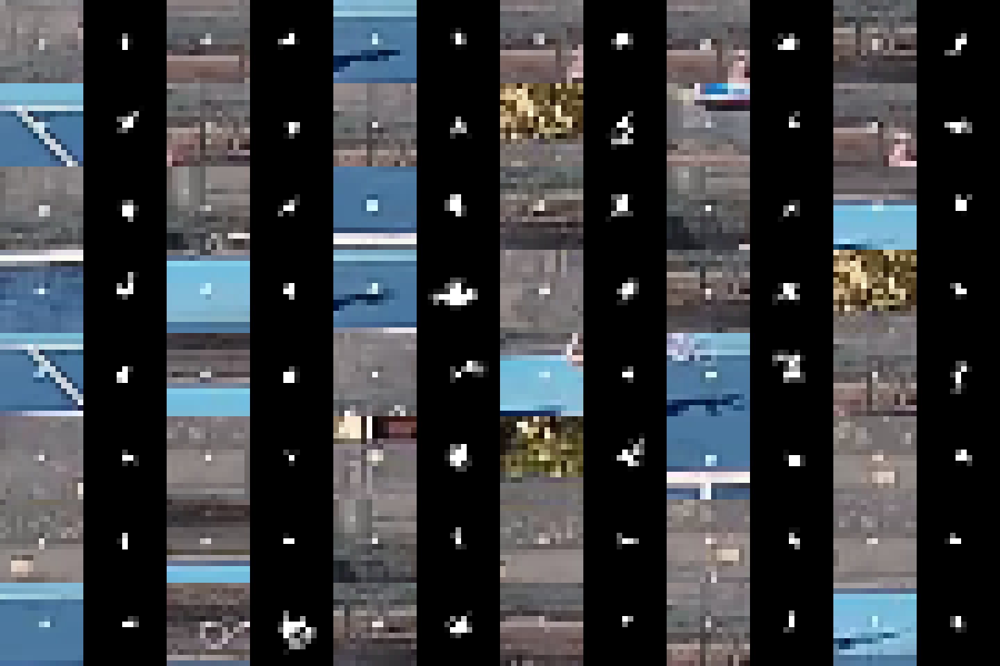
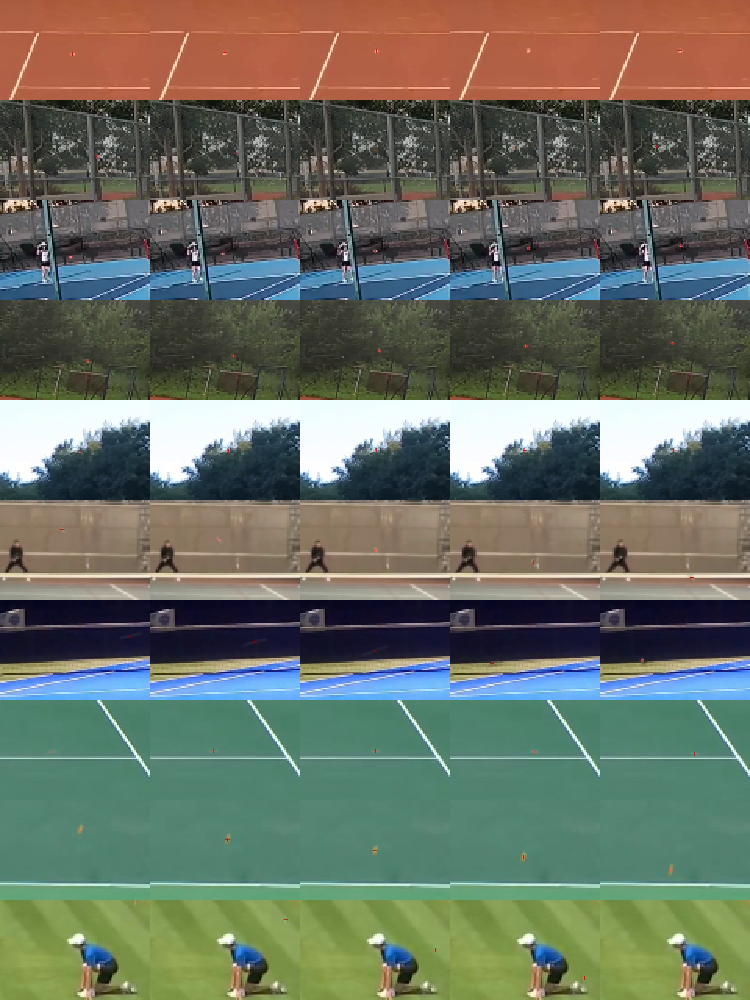

# Phase B: the training recipe and the Colab workflow (2026-10-27)

This record covers the decisions behind `finetune/training/distill.py`, `copy_paste.py` and
`pseudo_labels.py`. It also covers the trainer flags that use them, the Colab zip and
`finetune/Optimization_Train_Colab.ipynb`. Each decision has its evidence. Anything not measured
here is marked **untested**.

Machine: RTX 5080 Laptop GPU and the `tennis-opt` env. Every timed or GPU run went through the
shared lock (`optimization_test/tools/gpu_lock.py`).

## 1. Distillation

### 1.1 The heat-map loss: `qfl` (default) or `mse`

- **FPD** (Zhang et al., arXiv 1811.05419) distils a pose student with the MSE between the teacher's and
  the student's confidence maps, mixed with the label loss as `a L_label + (1 - a) L_mse`. Its Table 8
  finds MSE as good as cross-entropy (90.9 vs 90.7 PCKh). The weight barely matters: 0.05 to 0.99 all
  give 90.7 to 90.9. The paper's reason for MSE is that it matches the label loss.
- Our label loss is the CenterNet focal loss on sigmoid heat. Its continuous form against a soft target
  is GFL's **quality focal loss** (Li et al., arXiv 2006.04388, beta 2). BlurBall (arXiv 2509.18387)
  trains ball heat maps with it. QFL is therefore the analogue of FPD's "match the label loss" argument
  for this network.
- Both losses are summed over a frame's cells and averaged over frames. That puts them on the scale of
  the labelled loss, which is normalised by the balls (about one per frame). On FPD's evidence,
  `--distill-weight` defaults to 1.
- Offsets: the teacher's offsets enter as an L1 weighted by the teacher's heat (weight 1, the labelled
  offset loss's weight). Offsets only mean something where there is a ball.
- **Measured** (section 5.2): on the same budget, QFL distillation reached held-out recall 0.614. Focal
  alone reached 0.473 and MSE distillation 0.214. MSE puts its weight on the near-zero background
  cells, where the sigmoid student is already right, so it pulls little toward the ball. QFL stays the
  default.

### 1.2 Online teacher (default) or cached maps

- **Beyer et al.** (arXiv 2106.05237, "Knowledge distillation: a good teacher is patient and
  consistent"): the teacher and the student must see the same augmented view ("consistent teaching").
  A fixed or precomputed teacher plateaus lower and overfits. This makes `online` the default.
- `cache` is kept for slow GPUs. The dense-window average (as the tracker's prepass,
  `_HeatAverage`) is computed once per frame and carried through the flip, whole-cell shifts and the
  time reversal (tested in `tests/test_distill.py`). Photometric changes do not alter the cached maps,
  as in Noisy Student (arXiv 1911.04252), where the teacher sees clean input. A pasted ball is written
  into the maps as the labels have it.
- **Measured size and cost** (4 clips, 2,820 frames, extrapolated by frame count to the 32,962 frames
  the cache now holds):

  | | value |
  |---|---|
  | build time | 12.2 to 16.9 ms/frame over three locked runs: about 7 to 9 min for the whole cache |
  | size, float16 heat + offsets at 192x108 | 124 KB/frame, 0.33 GB for the 4 clips, about 3.8 GB in all |
  | deflate (np.savez_compressed) | 0.79 of raw (heat only: 0.81). Not worth it, so stored raw and memory-mapped |
  | training throughput, batch 4, heatmap_s4 | focal only 8.57 it/s, online 8.28 it/s (-3.4%), cache 8.83 it/s |

  Online teaching costs 3.4% of the step rate on this GPU. That is too little to give up consistent
  teaching for, so `online` stays the default. `cache` is for GPUs where the teacher is the bottleneck.

### 1.3 MGD (off by default)

- **MGD** (Yang et al., arXiv 2205.01529): a 1x1 align layer and a random mask, then a 3x3 conv, ReLU
  and 3x3 conv generation block. The loss is summed over C, H and W. The paper's one-stage detection
  setting is a 0.65 mask ratio and weight 2e-5 on neck features; it reports little sensitivity to the
  weight.
- Our neck features are the decoder blocks at strides 8 and 4. `feature_layers` finds them by probing
  the module's top-level children, so there is no per-architecture list. On heatmap_s4 they are `up1`
  (192 ch) and `up2` (96 ch). The adapters train with the student and are saved in the checkpoint.
- **Measured** (section 5.2): QFL + MGD (weight 2e-5) reached recall 0.487, below QFL alone (0.614).
  The raw MGD sum was about 4e5 per step, so at 2e-5 it added about 8 to the loss. That outweighed the
  heat-map term (kd_heat about 2.5). MGD stays off (`--mgd-weight 0`). A smaller weight is **untested**.

## 2. Pseudo-labels (Noisy Student)

- **Noisy Student** (arXiv 1911.04252): the teacher is not noised and the student is. Confident
  pseudo-labels are kept (0.3 threshold in the paper). Joint training beats pretrain-then-finetune.
  Balancing helps small models.
- **The filter was measured.** The shipped teacher (ctrl1, which never trained on `mixed_v1`) was run
  through the full pipeline (detector + selector, conf 0.5, window step 1) over the 24 `mixed_v1`
  clips: 9,033 labels, 8,515 of them visible and 518 absent. Results:

  | rule | kept | precision (within 10 px / truly absent) | median px |
  |---|---:|---:|---:|
  | every pipeline answer | 95.7% of visible | 0.9750 | 1.03 |
  | not recovered | 93.4% | 0.9849 | 1.02 |
  | + selected within 3 px (1080p) of the detector's own measurement | 80.1% | 0.9955 | 0.86 |
  | + in the timeline chain, track >= 10 detections, conf >= 0.7 (**chosen**) | 73.9% | **0.9989** | 0.83 |
  | same with conf >= 0.8 | 63.9% | 0.9998 | 0.81 |
  | absent: pipeline left the frame empty | | 0.487 | |
  | absent: no detection within 5 steps | | 0.805 | |
  | absent: no detection within 15 steps (**chosen**, 115 frames) | | **0.9913** | |
  | absent: no detection within 30 steps (36 frames) | | 1.000 | |

  Every other frame is `ignore`, which was 29% of the label frames on this set. The implementation
  (`pseudo_labels.frame_states`) was re-checked end to end on the same JSONs: ball precision 0.9989,
  coverage 0.738, none precision 0.9913 on 115 frames.
- An ignored frame is left out of the labelled loss entirely (`valid` mask, `loop.heatmap_loss`). It
  is neither positive nor negative, the way STAC (arXiv 2005.04757) and Soft Teacher
  (arXiv 2106.09018) keep uncertain pseudo boxes out of the background. The distillation loss still
  reads every frame.
- `--pseudo-share` defaults to 0.3. **Untested**: no pseudo-labelled video is on this PC yet. Noisy
  Student's larger unlabelled ratios helped its large students, while balancing helped small ones;
  our students are small, so the labelled data keeps the majority until a run measures otherwise.
- Sources: Mendeley 75m8vz7jr2 (v4, 2.42 GB, CC BY 4.0, 472 GoPro 1080p60 clips) and CalTennis
  (HF `demalenk/caltennis`, CC BY-NC 4.0, per-session download with `hf download --include`).
  Commands are in `finetune/COLAB_QUICKSTART.md` section 4.

## 3. Copy-paste ball with motion blur (`--augment copypaste`)

- **Kisantal et al.** (arXiv 1902.07296): pasting small objects many times raised small-object
  detection 7.1% relative on COCO. The ball here is 2 to 4 px at 768x432.
- **BlurBall** (arXiv 2509.18387): a moving ball is a straight streak along its velocity, its length
  speed x exposure, and the label is the streak's centre. The paper uses real blur only; the synthetic
  streak's own effect is not separated from the paste's. Section 5.2 measures them together.
- Banks are cut from the labelled training units only:
  - Ball crops come from frames where the ball moved at most 1.5 cache px per source frame (20.6% of
    labelled balls). The background is the per-pixel median of 3 frames of the same clip at least
    15 frames away.
  - Ball speeds outside `mixed_v1` (cache px per source frame): median 3.6, p75 7.1, p90 12.8.
  - Paths are real five-point unit paths, mirrored half the time and moved within 40 px of their own
    height.
- **Two fixes came from looking at the samples:**
  1. The first bank pasted crops of the same clip cut at other depths (oversized balls). Crops are now
     picked within 40 px of the paste's height.
  2. Mattes carried compression speckle, and a few discs held a player's hand
     (`opt_training_media/ball_bank_before_blob.png`). The matte now keeps the one blob nearest the
     label, and its mass is capped at 20.
- Current bank: 1,586 crops from 49 clips and 9,747 paths (training clips outside `mixed_v1`). The bank
  is cut once per run into the run dir. Pasting costs 0.5 ms per unit on the CPU.
- Samples. Crop and matte pairs: `opt_training_media/ball_bank.png`. Five-frame pastes, red cross on
  the label, 4x zoom: `opt_training_media/paste_samples.jpg`.

  
  

## 4. Colab

- `ft.py colab-zip` derives the code from the code. `colab_zip.code_files` walks the import closure
  of the trainer and the pseudo-label tool, function-level imports included, and writes the list to
  `code/code_manifest.json`. Both notebooks check that list.
- `tests/test_colab_notebook.py` copies only the staged files apart from the repository, imports every
  `ball_models` architecture and runs the trainer's self-test from them, which is what Colab does.
  The walker has its own unit test on a small tree.
- The closure grew from 36 files to 69. The pseudo-label tool's `label` command imports the tracker's
  headless pipeline. It is staged rather than special-cased.
- Zip size with today's workspace: 848.5 MB (86 videos 832.8 MB, labels 2.8 MB, model 12 MB, code
  0.8 MB). `--code-only` is 0.8 MB.
- The new notebook's first three cells were run locally against that real zip in a simulated Drive.
  Unpack took 1.4 s, the code check and torch 3.4 s, and the settings 5.5 s.
  `tests/test_optimization_notebook.py` does the same on a tiny workspace and parses the command it
  builds with the trainer's own parser.

## 5. Measurements

### 5.1 Smoke run (heatmap_s4 from scratch, `--distill` qfl online, `--augment basic translate copypaste`)

Settings: 150 steps per epoch, batch 4, val clip `grid_match8`, scored every epoch.

| epoch | train loss (focal + distill) | val focal | held-out recall | note |
|---:|---:|---:|---:|---|
| 1 | 37.42 (step 1: 447.0) | 4.40 | 0.000 | the bank (2,452 crops, before the matte fix) was cut into the run dir |
| 2 | 7.02 | 11.72 | 0.000 | |
| 3 | 4.48 | 3.81 | 0.011 | `--resume --epochs 3`: picked up after epoch 2 and kept the bank |

The loss falls, checkpoints are written every epoch, the resume continues the run, and scoring runs.
Recall is near zero after 450 steps from scratch, as expected.

### 5.2 Loss variants (heatmap_s4 from scratch, one epoch = 2,966 steps, batch 4, held out `mixed_v1`)

All variants use seed 7 and `--augment basic translate`; the last one adds `copypaste`. Each is scored
once at the end on the 24 `mixed_v1` clips (8,515 visible and 518 absent frames). This is one seed and
a short budget: it ranks the options early in training, not at convergence.

| variant | train loss | val focal | recall | wrong | false alarm | median px | minutes |
|---|---:|---:|---:|---:|---:|---:|---:|
| focal only | 3.17 | 1.327 | 0.473 | 0.007 | 0.012 | 1.02 | 4.9 |
| + distill MSE | 8.35 | 3.395 | 0.214 | 0.004 | 0.000 | 0.95 | 5.0 |
| + distill QFL (**default**) | 5.95 | **1.161** | 0.614 | 0.011 | 0.014 | 1.10 | 5.0 |
| + distill QFL + MGD 2e-5 | 13.92 | 1.608 | 0.487 | 0.008 | 0.015 | 1.05 | 4.9 |
| + distill QFL + copypaste | 5.83 | 1.174 | **0.640** | 0.015 | 0.021 | 1.01 | 6.4 |

- QFL distillation adds 14 points of recall over focal alone at the same step count.
- Copy-paste adds 2.6 more points. False alarms rise from 1.4% to 2.1% of absent frames. It is on in
  the notebook's default `AUGMENT`. One seed cannot tell whether the false-alarm rise is real; a full
  run's held-out score settles it.

## 6. Not done here

- A full-length distilled run against ctrl1's gates (`epoch_score` >= 0.840 on `mixed_v1`). That is
  the Colab run this work prepares.
- Pseudo-labelling real Mendeley or CalTennis video: the downloads (2.4 GB and 100+ GB) were not
  fetched.
- **Untested constants**, each set from the papers or the bank statistics rather than a sweep:
  `--pseudo-share` 0.3, `PASTE_P` 0.5, `CROP_DY_PX` and `PASTE_DY_PX` 40, `EXPOSURE` 0.25 to 1.0 of the
  frame interval, `--distill-weight` 1 (FPD found it insensitive) and an MGD weight below 2e-5.
